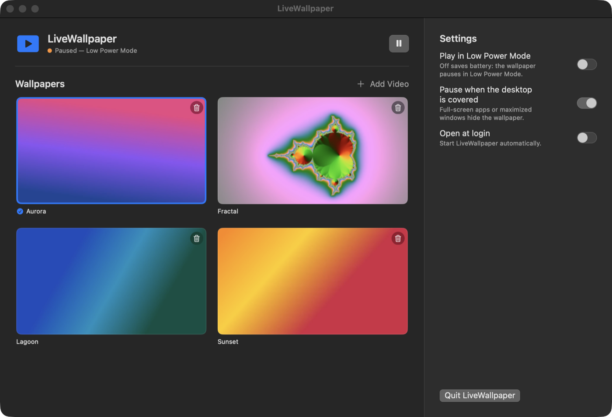

# LiveWallpaper

A tiny native macOS menu bar app that plays a looping video as your desktop wallpaper — and stops decoding it the moment nobody can see it, so it barely touches your battery.



## Features

- **Any video, converted automatically.** Add a `.mov`, `.mp4`, `.m4v` (or, with ffmpeg installed, `.webm`, `.mkv`, `.avi`…) and it's re-encoded to a muted, hardware-decodable HEVC file sized for your screen.
- **Sits behind your desktop icons** on every display and every Space.
- **Pauses itself when it can't be seen:**
  - a full-screen app or maximized window covers the desktop
  - the display or the Mac goes to sleep
  - the screen is locked, or another user is switched in
  - Low Power Mode is on (unless you choose otherwise)
- **Tells you when something is broken.** Files that can't be converted, damaged videos in your library and videos that fail during playback are clearly marked *Broken*.
- **Menu bar panel and a full app window** — same controls, one compact and one roomy (resizable, full-screen capable).
- **Settings:** play in Low Power Mode, pause when the desktop is covered, open at login.

## Why it's light on battery

| | |
|---|---|
| Hardware decoding | Every wallpaper is converted to HEVC, which Apple silicon decodes in dedicated media hardware. |
| No wasted pixels | Videos are capped near your screen's resolution (1080p or 4K) and stripped of audio. |
| Zero work while hidden | The player is paused — not just hidden — whenever the wallpaper isn't visible, so nothing is decoded. |
| No polling | Everything is driven by system notifications; there are no timers running in the background. |
| Display can still sleep | The player never holds a "keep display awake" assertion. |

## Requirements

- macOS 15 Sequoia or later (Apple silicon recommended)
- Swift 6 toolchain — Xcode 16+ or the Command Line Tools (`xcode-select --install`)
- Optional: [ffmpeg](https://ffmpeg.org) for formats macOS can't read natively (`brew install ffmpeg`)

## Build & run

```bash
git clone <this repo> && cd LiveWallpaper
./build.sh
open LiveWallpaper.app
```

`build.sh` compiles a release build and assembles an ad-hoc signed `LiveWallpaper.app` next to it. Move it to `/Applications` if you like.

## Usage

1. Click the ▶︎ icon in the menu bar (or open the app again to bring up its window).
2. **Add Video** and pick one or more files — or use Finder's *Open With → LiveWallpaper*. Conversion runs in the background with a progress bar.
3. Click a thumbnail to make it your wallpaper. The 🗑 button moves a video to the Trash.

Converted videos live in `~/Library/Application Support/LiveWallpaper/Videos/`.

## How pausing works

`PlaybackGate` keeps a set of reasons to pause (Low Power Mode, display asleep, screen locked, …) fed by `NSWorkspace`, `ProcessInfo` and distributed notifications, and plays only when that set is empty and the wallpaper isn't covered.

"Covered" is decided by checking whether any normal window covers a display's usable area (everything below the menu bar), using window bounds from `CGWindowListCopyWindowInfo` — no Screen Recording permission needed. It's re-checked whenever the active app or Space changes. (`NSWindow` occlusion state was tried first, but for desktop-level windows it gets stuck on "hidden" after leaving a full-screen Space.)

## Known limitations

- Maximizing or un-maximizing a window *without* switching apps isn't noticed until the next app or Space switch. Catching it without polling would require the Accessibility permission.
- The same video plays on every display.
- Builds are ad-hoc signed, so on another Mac Gatekeeper will ask you to confirm the first launch (right-click → Open).

## Project layout

```
Sources/LiveWallpaper/
  main.swift             app entry, AppModel (state + settings), menu bar panel & window
  PanelView.swift        SwiftUI UI used by both the panel and the window
  PlaybackGate.swift     all play/pause decisions
  Library.swift          import → convert (AVFoundation, ffmpeg fallback) → thumbnails / broken detection
  WallpaperWindow.swift  desktop-level window that loops the video
Resources/AppIcon.icns   app icon (regenerate with scripts/make-icon.swift)
build.sh                 builds LiveWallpaper.app
```
